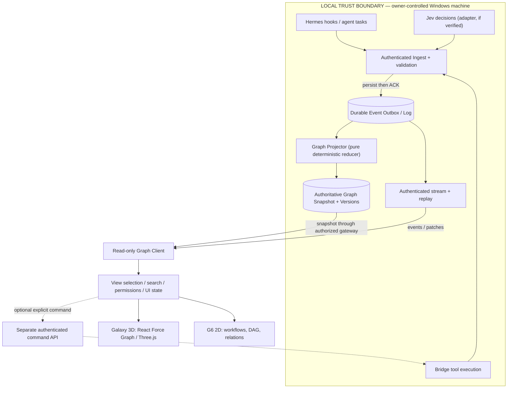

# 01 — System Architecture Blueprint

**Status:** Design proposal, not deployed. **Date:** 2026-10-09. **Branch:** `feat/jarvis-graph-3d` only. **Main:** unchanged.
**Scope:** Event producers, local trust boundary, canonical graph, two rendering projections and optional authorized commands.

## 1. Proven baseline / limitations

Directly inspected on feature branch 2026-10-09:
- `graph-3d/src/App.tsx` builds a seeded DEMO and cycles fixed `ROUTES` every 2500 ms. The label LIVE in that application is demonstrative, not proof of a real Hermes connection.
- `graph-3d/src/galaxy/GalaxyScene.tsx` imports `react-force-graph-3d` and Three.js UnrealBloomPass. Existing camera and scene are a useful visual starting point.
- `graph-3d/src/galaxy/types.ts` combines entity kinds, layout data and visual roles (core/hub/traffic). This is a renderer DTO, not a domain ontology.
- `js/events.js` exposes `J.ev.emit/on/events/replay` plus a browser-local reducer. Its MAX_EVENTS=400 means it cannot itself serve as a durable event log.
- `hermes/plugins/jarvis-events/__init__.py` sends events asynchronously via local `POST /bridge/agent-event` authenticated by `X-Bridge-Token`, via a queue of 500; bridge failure and queue overflow drop events with no retry.
- Live endpoint reachability, Bridge server auth rules, SSE replay support, a Windows runtime test, Vercel preview visual validation, persistence DB design and end-to-end delivery **not verified in this documentation pass**. Do not infer them from old port numbers or a READY deployment status.

## 2. Product/system boundaries



**Rule:** The renderer NEVER applies writes to authoritative state. It receives validated immutable snapshot/patch projections; browser client may maintain a local mirror. Source events are not render commands. Causation/evidence comes from verified ingest, not animation.

**Topology decision:** `graph-3d/` is a presentation module, not a new gateway or unrestricted API server. The *authoritative* Graph Store lives behind the local authenticated Bridge/gateway or another separately authorized trusted process. Browser mirror holds only permitted metadata. No secret is embedded in Vite environment exposed to the browser.

## 3. Four logical planes

1. **Event ingestion plane** — producer adapters, auth, event validation, append-only log and ACK. Existing hooks remain readable through a backward compatible legacy adapter.
2. **Canonical domain plane** — stable IDs, entities, edges, revisions, graph projection, snapshot and patch selection; independent of Three.js/G6.
3. **Presentation plane** — shared client mirror, selected IDs, timeline, inspector, L0–L3, Galaxy 3D, G6; 3D physics positions belong only to layout state.
4. **Command plane (optional, not in v2 view-only MVP)** — explicit action intent, permission, approval where needed, idempotency key, auditing and *verified Bridge result*. Clicking a node must not silently call a tool.

## 4. Interfaces and ownership

| Unit | Consumes | Produces | Owns | Never owns |
|---|---|---|---|---|
| Hermes adapter | trusted hook samples | versioned JarvisEvent | mapping and producer ID | source-of-truth task status |
| Bridge ingest | authenticated producer messages | ACK + durable log append | transport validation | 3D visualization |
| Event Log | validated events | cursor/replay | ordering within contract | UI animations |
| Projector | ordered events | deterministic GraphPatch | graph domain semantics | shader or camera |
| Graph Store | patches | versioned snapshots/query results | authoritative graph | physical xyz layout |
| Graph Client | snapshot + patches | UI subscriptions | redacted local mirror | producer token |
| GalaxySelector | snapshot, search, focus, LOD | renderer DTO | visualization grouping | entity truth |
| G6Selector | snapshot, DAG policy, focus | G6 Node/Edge/Combo data | deterministic 2D projection | mutations without API |
| CameraDirector | navigation state | imperative camera calls | user camera policy | domain changes |
| EvidenceInspector | correlated verified events | human-readable proof | display | claiming a tool succeeded |

## 5. Graph update paths

**Read path:**
1. Authorized UI requests snapshot at version N + access scope.
2. Client receives filtered entities, edges and matching cursor.
3. Stream provides patches/events; check `baseVersion===local.graphVersion`.
4. If version mismatches: buffer briefly, request bounded replay; if unavailable, fresh snapshot. NEVER splice an incompatible patch.
5. UI selectors derive both 3D and G6 data from same version; visual animations are effects of applied state changes.
6. Closing/reopening a view does not reconstruct random IDs.

**Write path (future, separately authorized):**
1. User proposes a command with target ID, expected revision and requested permission.
2. Gateway verifies authenticated user, action, resource and any approval.
3. Bridge executes, records result, produces event; projector updates graph only on confirmed evidence.
4. Failed, timed-out, denied and cancelled outcomes are distinct.

## 6. Hosting decision: LOCAL first, hosted demo separate

- **LOCAL/authorized** can show a live graph; how browser securely reaches local Bridge requires direct verified topology. The presence of a local loopback endpoint alone does not authorize exposing it to an arbitrary HTTPS origin.
- **Vercel Preview** defaults to clearly labelled DEMO with synthetic fixtures. It does not embed `X-Bridge-Token`, proxy unguarded requests into localhost, or expose event log/memories publicly.
- Remote access is a separate security project requiring user consent, robust identity, resource-scoped authorization, transport protection and threat testing.
- Browser `EventSource` does not support arbitrary headers for token auth. Cookie/session same-origin gateway or an authenticated fetch-stream mechanism must be deliberately selected; never move a privileged Bridge token to query strings.

## 7. Target repository layout (proposed; no code files created)

```text
graph-3d/src/
  graph/domain/          entity, relation, patch, provenance, selectors
  graph/projector/       eventToPatch, version checks, replay tests
  graph/client/          snapshot, transport, connectionState, viewStore
  galaxy/                existing Three.js renderer DTO and scene
  workspace/             independent lazy-loaded AntV G6 canvas
  interaction/           focus FSM, semantic zoom, inspector
  quality/               telemetry, resource budgets, reduced motion
hermes/plugins/jarvis-events/  backward-compatible producer adapter
[existing trusted backend]     durable ingest, log, projector, read gateway
```

Do not introduce new server path before inspecting the running Bridge repo and verifying deployment topology.

## 8. Architecture Decision Records

| ADR | Decision | Alternative rejected/deferred | Rationale |
|---|---|---|---|
| ADR-001 | Keep `react-force-graph-3d` + Three.js | Rewrite renderer with G6-3D | Existing app has substantial custom scene work |
| ADR-002 | Separate `@antv/g6` operational canvas | Blend G6 into 3D canvas | Independent layouts, semantics and performance |
| ADR-003 | One canonical graph + versioned patches | Renderer-owned node mutation | Consistency and deterministic replay |
| ADR-004 | Existing Hermes → Bridge path, hardened | Kafka/NATS upfront | Avoid unnecessary infrastructure |
| ADR-005 | Authenticated durable ingest + SSE read initially | Blind unprotected WS/localhost bridge | Producer and viewer needs differ |
| ADR-006 | Data-driven motion; DEMO explicitly marked | Continuous fake LIVE activity | Proof/evidence trust |
| ADR-007 | Local live only until security review | Public production stream by default | Protect private desktop/memory |

These are **recommendations to ratify at Gate 0/contract freeze**, not claims of completed changes.

## 9. Implementation slices and exit gates

1. **Baseline (Gate 0)** — capture branch SHA, real browser screenshot, tests, dependency versions.
2. **Domain contract (Gate A0)** — ontology, ID mapping, canonical patch tests and fixtures.
3. **Read-only end-to-end slice** — one verified Hermes event -> local ingest -> projector -> Graph Client -> highlighted node with provenance.
4. **Reliability slice** — duplicate/retry, out-of-order/gap, reconnect, replay/resync and offline last-good state.
5. **Experience slice** — semantic LOD, hover, camera FSM, mobile/reduced motion.
6. **G6 slice** — same IDs, same selection/inspector and DAG cycle policy.
7. **Release** — real E2E, perf, security, preview protection, explicit promotion review.

## 10. Open verification questions

- Which exact Bridge service currently handles agent-event and SSE, what auth/Origin/CSRF policies, and does it persist anything?
- Which authenticated source produces Jev decisions and which schema/version exists?
- Where should authoritative local log and graph state persist? SQLite/WAL vs existing data store?
- What metadata may leave the machine, if any, and who is authorized to see it?
- Does a message from Hermes signify intention, a completed tool outcome or both? What is authoritative execution evidence?
- How are browser sessions and paused/not-visible tabs handled across process restart?
- Do current feature CI and preview match the same SHA? No claim until verified.

## Primary references

- [Local source files on feature branch](https://github.com/majkel2403/Jarvis-/tree/feat/jarvis-graph-3d)
- [React Force Graph](https://github.com/vasturiano/react-force-graph)
- [G6 Graph framework](https://g6.antv.antgroup.com/en/manual/data/)
- [CloudEvents specification](https://github.com/cloudevents/spec/blob/main/cloudevents/spec.md)
- [OWASP validation](https://cheatsheetseries.owasp.org/cheatsheets/Input_Validation_Cheat_Sheet.html)

**Policy:** This document is design only. No `main` changes or deployment are authorized.
