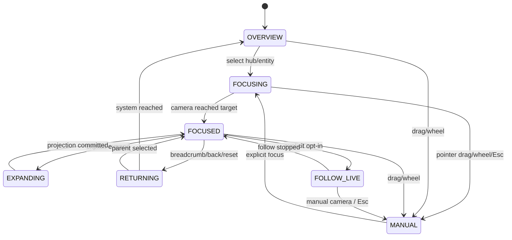

# 04 — Interaction and Semantic Zoom State Machines

**Status:** Interaction specification v2 (proposed). **2026-10-09.** Implementation not started.  
**Prerequisite:** `01-system-architecture.md` and `02-graph-ontology-contracts.md` canonical IDs and projections.

## 1. Product interaction promise

Jarvis is a navigable knowledge-and-execution universe, not a graph screenshot. Every spatial gesture should reveal a new layer of *meaning*, not just enlarge the same spheres. The user can interrupt every automated motion; live events may update the scene but never steal camera control except in explicitly selected FOLLOW LIVE.

## 2. Navigation hierarchy

| Semantic level | Visible content | Default labels | Primary interaction | Exit |
| --- | --- | --- | --- | --- |
| L0 Universe | Jarvis system, domain hubs, aggregated inter-cluster edges, live totals | Jarvis + main hubs | click cluster / search | Reset |
| L1 Cluster | team/project/topic anchors, counts, active entities, relationships | primary entities | expand subgroup / hover | breadcrumb back |
| L2 Neighborhood | selected agent/task/project + 1–2-hop relations, direction and status | focus + neighbors | inspect edge, multi-select, deeper expand | breadcrumb back |
| L3 Evidence | focused entity + correlated action/task timeline, source links and proof | evidence summaries | time range, inspect event, replay | breadcrumb back |
| 2D Workspace | G6 DAG/force/radial/combo projection of selected canonical scope | adaptive | investigate relations, compare paths | toggle back to 3D |

Level transitions are driven by an explicit navigation state (`level, selectedNodeId, expandedIds, scope, cameraTarget`), which may respond to zoom threshold **with hysteresis** but does not automatically expose hidden private data. L3 is an inspector/evidence mode, not a promise of a fully separate 3D universe.

## 3. State machine — user navigation



**No race conditions:** every camera request receives a monotonically increasing `requestId`. Completion callbacks compare their ID against current request; outdated completions do nothing. There must be no layout-driven stale camera jumps.

## 4. Camera director contract (proposal)

```ts
type CameraMode = 'OVERVIEW'|'MANUAL'|'FOCUSING'|'FOCUSED'|'EXPANDING'|'RETURNING'|'FOLLOW_LIVE';
interface CameraRequest {
  requestId: number;
  targetId?: string;
  position?: [number,number,number];
  lookAt: [number,number,number];
  durationMs: number;
  reason: 'click'|'breadcrumb'|'fit'|'follow'|'reset'|'search';
}
interface CameraState {
  mode: CameraMode;
  requestId: number;
  focusEntityId: string | null;
  lastUserInteractionAt: number;
}
```

- On node click: update canonical selection immediately; compute camera transition from current camera and selected 3D coordinates; fly to point at distance based on visible radius, FOV and viewport aspect ratio.
- On Reset: compute bounds of **visible entities**; not hard-coded `z=930`.
- On unavailable/removed target: retain camera until valid fallback; show 'entity hidden / no longer available' in inspector.
- On manual interaction: cancel pending camera transition, do not re-run obsolete focus effect.
- On reduced motion: focus moves without tween; navigation remains complete.
- Camera positioning and `zoomToFit` are renderer primitives; semantic level selection and interrupted transitions are *application logic*, not built-in features.

## 5. Semantic viewport thresholds

Avoid relying on raw camera z. Let `r` be projected radius of focused cluster / entity, `d` distance to its center and `fov` camera field of view. Choose thresholds after browser testing with viewport. Use a hysteresis band to prevent 'flicker' when camera oscillates near a threshold.

Suggested initial evaluation (NOT validated values):
- L0 default until a main hub is explicitly entered.
- L1 after an explicit hub selection or projected cluster diameter exceeds ~250 screen pixels.
- L2 after individual entity focus, or manual zoom near enough with focus context.
- L3 only after Inspector → Evidence action (never automatically show private proof by wheel alone).

All changes must preserve consistent canonical node IDs, selection and permission scope.

## 6. Gesture contract

| User action | Expected | Must not |
| --- | --- | --- |
| Hover node | highlight node + 1-hop relations; dim others | reheat force / move camera |
| Hover edge | direction, relation kind, provenance tooltip | display unsafe event HTML |
| Click node | select, inspector, soft camera focus | perform a tool/agent command |
| Double click / Expand | reveal subgroup with stable IDs and positions | duplicate nodes |
| Shift+Click | add/remove ID from selection set | overwrite another selection |
| Background click | clear transient hover, preserve navigation history | reset entire graph without confirmation |
| Drag node | temporary force displacement; pin only on explicit toggle | persist layout automatically |
| Scroll/pinch | zoom while preserving focus | trigger unauthorized data fetch |
| Esc | cancel cinematic/motion, close mobile panel, clear ephemeral overlays | cancel actual agent tasks |
| Search / Ctrl+K | focus search; jump to canonical entity | search raw private memory without authorization |
| Breadcrumb | return to earlier semantic scope and camera | reconstruct fake IDs |
| FOLLOW LIVE | follow selected task's verified correlated events | switch camera on unrelated background events |
| PAUSE EVENTS | stop demo playback/subscription visual emissions (with explicit cursor policy) | disable clicks/orbit |
| FREEZE SCENE | stop renderer motion, clearly state controls may stop | claim transport disconnected |

## 7. Visual selection and event state

Canonical state:
```ts
interface ViewState {
  level: 'universe'|'cluster'|'neighborhood'|'evidence';
  scopeId: string | null;
  selectedIds: ReadonlySet<string>;
  hoveredId: string | null;
  expandedIds: ReadonlySet<string>;
  focusedEntityId: string | null;
  followedCorrelationId: string | null;
  search: string;
  filters: { kinds: string[]; statuses: string[]; projectId?: string };
  motion: 'normal'|'reduced';
  eventsPaused: boolean;
  sceneFrozen: boolean;
}
```

The Graph Store retains domain state; ViewState is local presentation state. A filtered entity remains an Inspector selection **only if** a clearly displayed 'hidden by active filter' state is used; camera focus must not try to target invisible geometry.

## 8. Expand/collapse policy

- Expand children determined from explicit `contains`/`member_of`/chosen team hierarchy edges; guard cycles.
- Summaries show child count, hidden count, active count and error count with neutral semantic labels.
- Close cluster: aggregate its child edges into an abstract presentation edge, not a persistent domain relation.
- On expand or filter change, reuse stored layout positions for existing objects and seed new positions near parent, then reheat only topology-affected section where practical.
- Keep progressive disclosure so thousands of memory records do not render in L0.
- If snapshot arrives mid-expand, reconcile by stable IDs; no orphan ghost mesh or phantom selection.

## 9. Animation choreography (event-driven)

```text
Verified task.created:
  Hermes hub pulses briefly → task appears in owning project cluster
Verified tool.started:
  emitParticle(actor → tool) + tool status running
Verified tool.completed / tool.failed:
  status change + related evidence indicator; failure gets brief outer ring
Verified memory.written:
  new memory/reference appears only when write confirmed by source
Confirmed task.completed:
  completion ripple; keep camera still unless FOLLOW LIVE enabled
approval.requested:
  clear warning in Inspector/live panel, not a forced cinematic cut
Disconnected:
  last good graph stays in place, activity goes stale, visible timestamp
```

Ambient stars, glows and slow orbit are visual atmosphere, not evidence. Clearly distinguish SIMULATED and LIVE. Do not use infinite generic particles as purported proof of runtime activity.

## 10. Accessibility and mobile

- 390×844 and 320px width test fixtures: inspector as reachable bottom sheet; close/Esc behavior; controls minimum usable touch targets; readable contrast and labels.
- Maintain keyboard-accessible searchable entity list / 2D relation table as alternatives to pointer-only 3D selection.
- Screen reader gets node identity, status, relation type and count from DOM list, not raw canvas.
- Respect `prefers-reduced-motion` at initialization and on preference change; auto-orbit, decorative motion, animated camera and Bloom/motion budgets adapt accordingly.
- Tooltips hide on hover out, scroll and navigation; no stuck overlay.

## 11. Acceptance examples

1. Select Hermes at L0 -> L1 changes node membership, not just zoom; breadcrumb shows `Jarvis > Hermes`.
2. Select agent -> L2 shows direct neighbors and relation directions, hover highlights precisely one hop.
3. Open Event Evidence -> L3 includes `correlationId` and confirmed tool outcome; no false success.
4. Rapid select A/B/C while tweening -> final camera and inspector focus C only.
5. Filter hides selected project -> visible explanation and no camera NaN.
6. Pause demo event flow -> no active emitted particles, pointer interactions and orbit stay responsive.
7. Switch to 2D and back -> same selected canonical ID.
8. Reduced motion -> no autoplay and no user takeover, all information reachable.

## 12. Design decisions requiring browser validation

- Zoom transition distance formula, timing 350–1200 ms and hysteresis values.
- Whether double-click expands or shows extra ambiguity; explicit Expand button always available.
- Whether multi-select uses Shift on desktop and checkboxes on touch.
- Visual differentiation between a single agent, a team and a project at 0.5-second glance.

## References

- [React Force Graph examples/API](https://github.com/vasturiano/react-force-graph)
- [3D Force Graph examples](https://github.com/vasturiano/3d-force-graph)
- [W3C WCAG 2.2](https://www.w3.org/TR/WCAG22/)
- [MDN prefers-reduced-motion](https://developer.mozilla.org/en-US/docs/Web/CSS/@media/prefers-reduced-motion)
