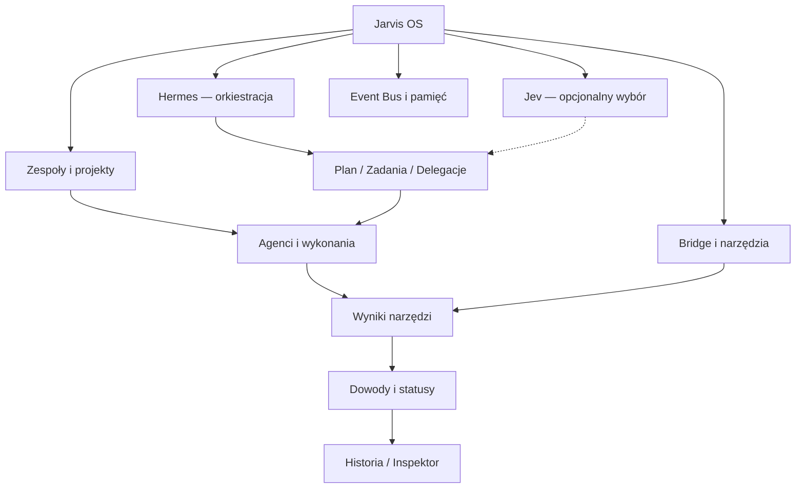

# 11 — Jarvis Mission Control: specyfikacja centrum dowodzenia

> **Design review alignment (2026-10-10):** See [Unified System Design 14](14-unified-system-design-review.md). SYSTEM/AGENTS/PROJECTS/MEMORY/LIVE remain the five top-level modes; Mission/Team/Trace/Timeline are contextual subviews, not new independent stores. Event names in the catalogue are semantic mapping *candidates* until authorized source inventory. Never equate LLM text or unverified task completion with a confirmed tool result.

**Status:** DRAFT / projekt do przeglądu, bez implementacji.  
**Miejsce:** repo eksperymentów `Experental-MajkelVibeCode/jarvis-graph-3d`, osobna gałąź dokumentacyjna.  
**Cel:** Jeden spójny widok operacyjny, który pomaga zrozumieć kto, co, dlaczego i z jakim skutkiem robi w Jarvisie. Nie jest to system automatycznie wykonujący polecenia po kliknięciu grafu.

## 1. Historia użytkownika

Użytkownik zleca Hermesowi „Zaprojektuj i zbuduj aplikację AI”. W centrum widać cały projekt i jego etapy. Hermes planuje pracę; Jev (jeśli aktywny) może sklasyfikować lub pomóc wybrać akcję; agenci i zespoły realizują fragmenty; Bridge/narzędzia potwierdzają wykonanie. Każda relacja i status ma źródło, czas i ścieżkę dowodową. Gdy ktoś utknie, użytkownik widzi przyczynę i zależne zadania. Wersja DEMO odtwarza scenariusz syntetyczny i jest wyraźnie oznaczona.

## 2. Podstawowa zasada: trzy różne rzeczy

- **Intencja:** Hermes planuje wykonać zadanie. Nie znaczy, że narzędzie zostało uruchomione.
- **Próba:** agent wywołuje narzędzie lub deleguje pracę. Może być w toku, anulowana lub odrzucona.
- **Potwierdzony skutek:** narzędzie/Bridge albo inny właściwy system zwraca wynik i dowód. Dopiero wówczas UI może pokazać potwierdzony rezultat.

Wizualne kolory muszą odpowiadać semantyce, a nie treści swobodnej wypowiedzi modelu.

## 3. Role i autorytet danych

| Element | Rola | Czego NIE zakładać |
|---|---|---|
| Jarvis/system | warstwa nadrzędna i mapa całości | centralny obiekt 3D nie jest osobnym wykonawcą narzędzi |
| Hermes | rozmowa, orkiestracja, podział zadania | tekst „skończyłem” to nie dowód wykonania |
| Jev | opcjonalna szybka warstwa klasyfikacji i wyboru | nie klika, nie uruchamia narzędzi i nie musi być aktywny |
| Team/Manager | logiczne grupowanie odpowiedzialności, niekoniecznie osobny proces | 20 managerów na grafie nie oznacza 20 działających instancji |
| Agent | wykonawca z identyfikatorem, rolą i dostępnymi narzędziami | planowana rola nie dowodzi istnienia aktywnej sesji |
| Bridge / Tool | autorytatywne potwierdzenie uruchomienia i rezultatu działań | sam start narzędzia nie dowodzi skutku ubocznego |
| Memory | zapisane, autoryzowane referencje do wiedzy | nie wstawiamy całych prywatnych plików do grafu |
| Event Bus | transport faktów/procesów i ich historii | odbiór zdarzenia nie oznacza trwałego zapisu bez ACK |

Zgodność terminów: `GraphEntity`, `GraphRelation`, `GraphSnapshot`, `GraphPatch`, `JarvisEventV1` z propozycji Blueprint 02, 03 i ADR 08. Do zatwierdzenia w jednym contract freeze.

## 4. Hierarchia Mission Control

**Nie łączyć dwóch niezależnych statusów w jeden:** aktywność agenta, status zadania, status połączenia i status wykonania narzędzia mają osobne znaczenia.

## 5. Pięć widoków tego samego projektu

| Widok | Zawartość | Główne pytanie |
|---|---|---|
| **Universe** | zagregowany stan całego Jarvisa, aktywne domeny | Co się dzieje w systemie? |
| **Mission** | jeden cel, plan, zależności, kamienie milowe | Co trzeba zrobić, żeby osiągnąć cel? |
| **Team** | odpowiedzialności, delegacje, kolejki i aktywne sesje | Kto za co odpowiada? |
| **Trace** | konkretne wywołania, decyzje, receipty, błędy, retry | Dlaczego tak się stało? |
| **Timeline / Replay** | źródłowe zdarzenia i historyczne stany | Kiedy i w jakiej kolejności to zaszło? |

Wspólna selekcja musi działać między galaktyką 3D, G6, tabelą i inspektorem. `FOLLOW LIVE` jest opcjonalne; bez niego zdarzenie nie przejmuje automatycznie kamery.

## 6. Karta agenta i karta zadania

**Karta agenta — wymagane pola (jeśli zweryfikowane):**
- stabilny `agentId`, nazwa, rola, team/project, dostępność lub wyraźnie `unknown`;
- lista ostatnich potwierdzonych działań i aktualne zadania;
- źródło, `lastSeenAt`, status sesji i status transportu;
- jawnie oznaczone zdolności/skille vs wykonane operacje.

**Karta zadania:**
- `taskId`, parent/project, planowane kroki, zależności i blokady;
- owner/assignee, runId, aktualny status (queued/running/blocked/succeeded/failed/cancelled);
- correlation ID, ostatnia wersja grafu, historia prób i linki do potwierdzonych wyników;
- wariant „brak zweryfikowanego dowodu” zamiast fikcyjnego sukcesu.

**Karta relacji:** typ, kierunek, źródło, czas, ważność, status i źródłowa referencja.

## 7. Zdarzenia, które realnie zmieniają Mission Control

| Zdarzenie | Zmiana semantyczna | Sygnał na ekranie |
|---|---|---|
| task.created | nowy task + powiązanie z projektem | pojawia się węzeł i wpis w osi czasu |
| task.assigned / delegated | zmienia assignee i relację | nowa skierowana relacja |
| model.started | status aktywności modelu | delikatny obrys, bez potwierdzania wyniku narzędzia |
| judge.decision | nowa decyzja z provenance | węzeł decyzji / opis bez fałszywego „wykonał” |
| tool.started | uruchomiono próbę wykonania | jednorazowy sygnał po istniejącej krawędzi |
| tool.completed / tool.failed | zapis wyniku próby + evidenceRef | status i dowód lub błąd |
| approval.requested | wymagana zgoda i zadanie może czekać | bursztynowa blokada + panel |
| memory.written | potwierdzony trwały zapis | powstaje referencja pamięci |
| source.disconnected | strumień jest nieaktualny | STALE, zachowany ostatni snapshot |
| task.completed | koniec zadania wg wiarygodnego źródła | completion bez zakładania sukcesu wszystkich skutków |

Nazwy są **propozycją kanonicznego mapowania**; rzeczywiste źródła Jev/Bridge wymagają przyszłej weryfikacji read-only.

## 8. Zależności i propagacja blokad

Jeśli zadanie backendu blokuje frontend testowany E2E, graf powinien pokazać:
- **bezpośrednią blokadę** na krawędzi `depends_on`;
- **potencjalny wpływ** na downstream tasks jako wynik analizy grafu — nigdy jako pewność błędu;
- ścieżkę od objawu do przyczyny: zależność → zadanie blokujące → ostatnia operacja → potwierdzony wynik lub brak dowodu.

G6/DAG jest narzędziem analizy zależności. Jeśli `depends_on` tworzy cykl, pokazać ostrzeżenie i widok sieciowy, a nie udawać poprawnego DAG.

## 9. Wariant 20 menedżerów + 100 agentów

Ten wariant jest **scenariuszem symulacyjnym do Playground**, nie twierdzeniem, że mamy już 120 aktywnych AI.
- L0: jeden hub organizacji i zbiorcze statystyki;
- L1: 20 zespołów z liczbą członków, zadań, blokad i aktywnych źródeł;
- L2: 5 agentów danego zespołu + relacje delegacji i zadania;
- L3: jedna sesja/zadanie i dowody.
- Agregaty liczone wyłącznie ze zbioru encji dostępnego użytkownikowi; nie przeciekają ukryte zespoły.

## 10. Prawa i bezpieczeństwo

Domyślnie graficzny widok jest **read-only**. Kliknięcie nodu nie uruchamia narzędzia, delegacji ani ponownej próby. Przyszłe przyciski `RETRY`, `CANCEL`, `APPROVE` wymagają osobnej specyfikacji komend, uprawnień, potwierdzenia i audytu. Vercel Preview pozostaje syntetycznym DEMO bez lokalnych tokenów.

## 11. Scenariusze odbiorcze — projekt testów, NIE uruchomione

1. Dwa zadania tej samej misji mają różnych wykonawców: Trace i Team wskazują identyczne canonical IDs.
2. Hermes pisze „skończone”, lecz Bridge nie zwrócił receiptu: operacja pozostaje niepotwierdzona.
3. Przyszło `approval.requested`: nie ginie pod natłokiem dekoracyjnych eventów.
4. Zależy A→B→C, B failed: widoczna bezpośrednia blokada i analityczny downstream risk, bez automatycznego sukcesu ani winy C.
5. Jev wyłączony: reszta misji nadal działa, zamiast pokazywać fikcyjną decyzję.
6. Bridge offline: ostatni snapshot i historyczne dowody dostępne, status STALE.
7. 120 fikcyjnych członków w DEMO: L0 pozostaje czytelne dzięki agregacji.
8. Ten sam agent w Mission, Galaxy i G6 ma ten sam ID i zgodne uprawnienia.

## 12. Pytania wymagające akceptacji

- Czy Mission Control jest **tylko do obserwowania**, czy w odległej wersji także do zarządzania wykonaniem? Ta specyfikacja zakłada read-only.
- Czy jednym „zadaniem” jest plan Hermesa czy konkretne uruchomienie? Zalecenie: osobne `task` i `run`.
- Kto jest autorytatywnym źródłem sukcesu: hook, Bridge, testy E2E czy stan artefaktu? Wymagane mapowanie per typ czynności.
- Jak liczymy postęp: potwierdzone kroki, a nie liczba tokenów ani same komunikaty modelu.
- Czy przedstawiać historię delegacji jako relacje z czasem ważności, czy tylko aktualną strukturę? Rekomendacja: aktualna projekcja + historia w Timeline.

**Powiązania:** [Architektura](01-system-architecture.md), [Ontologia](02-graph-ontology-contracts.md), [Event Bus](03-event-bus-protocol.md), [Interaction](04-interaction-semantic-zoom.md), [ADR](08-architecture-decisions-candidate.md), [Acceptance](10-acceptance-scenarios-and-evidence.md).

**Ograniczenie:** Tylko specyfikacja. Nie stanowi zgody na kodowanie, modyfikację `main`, runtime Hermesa/Bridge czy wdrożenie.
