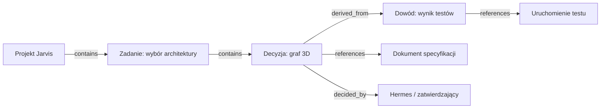

# 12 — Jarvis Second Brain: mapa pamięci, skojarzeń i dowodów

> **Design review alignment (2026-10-10):** See [Unified System Design 14](14-unified-system-design-review.md). `persisted` is a proposed *persistence-verification state*, **not** a member of `GraphEntity.status`; `suggested/verified/stale` relationship flags are proposed typed metadata and are **not yet** fields in Blueprint 02 `GraphRelation`. They require contract approval; suggested links must not masquerade as verified facts.

**Status:** DRAFT / projekt, nie implementacja. **Data:** 2026-10-10.
**Miejsce:** dokumentacja osobnego eksperymentu Jarvis Graph 3D, bez zmian w żadnym `main`.

## 1. Co użytkownik ma zyskać?

Zamiast pytać „czy pamiętasz?”, użytkownik może wejść do przestrzennej mapy wiedzy i prześledzić:
- **co** Jarvis wie o zadaniu/projekcie;
- **skąd** pochodzi informacja, kiedy została zaobserwowana i czy jest aktualna;
- **dlaczego** podjęto decyzję i na jakich dowodach ją oparto;
- **jak** konkretna wiedza łączy się z agentami, plikami, zadaniami i narzędziami.

Second Brain nie jest modelem neuronów LLM ani zapisem ukrytego procesu myślowego modelu. To **nawigowalny graf jawnie zapisanych informacji, decyzji i źródeł**.

## 2. Trzy osobne warstwy wiedzy

| Warstwa | Zawartość | Źródło | Zasada wiarygodności |
|---|---|---|---|
| **Pamięć utrwalona** | zapisy, indeksy, notatki, repo dokumentów, pliki | zatwierdzony Obsidian/Hermes memory source lub inne wskazane repo | węzeł jako `persisted` tylko po potwierdzeniu zapisu |
| **Wiedza o pracy** | projekty, zadania, decyzje, tool calls, wyniki i artefakty | Event Bus + Bridge receipts + rejestry | zdarzenie nie może samo w sobie udawać skutku działania |
| **Wiedza pochodna** | powiązania semantyczne, podobieństwa, potencjalne zależności | jawny algorytm lub model tworzący propozycję | status `suggested`, pochodzenie i confidence, nie fakty |

**Nigdy nie mieszać** „model przypuszcza” z „źródło potwierdza”.

## 3. Kanoniczne obiekty i relacje

Wykorzystać `GraphEntity` i `GraphRelation` z Blueprint 02, bez nowej konkurencyjnej ontologii.

**Węzły często używane:** `project`, `task`, `run`, `agent`, `memory`, `decision`, `file`, `artifact`, `evidence`, `person` (tylko uprawniony zakres).

**Relacje:** `references`, `derived_from`, `decided_by`, `produced`, `uses`, `contains`, `related_to`.

Dodatkowe właściwości **relacji**, nie nowe rodzaje węzłów:
- `verification: verified | suggested | contradicted | stale`;
- `confidence?: number` wyłącznie jeśli źródło rzeczywiście ją wystawia; nie udawać obliczonej wiarygodności;
- `sourceRef`, `observedAt`, `updatedAt`, `validFrom` i opcjonalne `validTo`;
- klasyfikacja i uprawnienia na krawędziach równie restrykcyjne jak na obiektach końcowych.

Jeśli nowe pola są potrzebne w kontrakcie, opisać rozszerzenie w ADR i zatwierdzić przed implementacją. Nie dodawać ich w ciemno.

## 4. Semantyczne poziomy mapy pamięci

| Poziom | Co pokazujemy | Układ |
|---|---|---|
| L0 — Knowledge Universe | duże obszary: projekty, decyzje, pamięć, artefakty; liczby wyłącznie dozwolone | konstelacje i zagregowane huby |
| L1 — Temat / Projekt | główne zbiory wiedzy, powiązane projekty i źródła | klastry i mosty |
| L2 — Pojęcie / Zadanie | jeden element, bezpośrednie relacje oraz ścieżki 1–2 hop | lokalna sieć |
| L3 — Źródło i dowód | pochodzenie, wersja, daty, konflikt, potwierdzenie wykonania | panel dowodów + oś czasu |
| Workspace G6 | dokładne relacje `derived_from`, `depends_on`, łańcuchy dowodowe | 2D DAG/force z kontrolą cykli |

**Prywatne źródła nie mogą ujawniać swojej obecności przez agregaty, nawet jeśli ich etykiety są ukryte.**

## 5. Przykładowy łańcuch: skąd Jarvis wie o decyzji?

Kliknięcie decyzji powinno dawać odpowiedź: **co wybrano, na jakiej podstawie, kiedy i jak zweryfikowano**. Brak potwierdzonego testu musi być pokazany jako brak dowodu, nie zastąpiony ogólną narracją.

## 6. Zasady ingestu i synchronizacji pamięci

Przyszły proces (nie wykonany):
1. Odczyt **wyraźnie autoryzowanego** indeksu pamięci i plików, nie całej zawartości dysku.
2. Mapowanie rekordów na stabilne IDs, z uwzględnieniem przenosin/rename/deletion.
3. Walidacja, klasyfikacja poufności i redakcja **przed** projekcją do klienta.
4. Potwierdzenie, czy zapis jest trwały; niepokryte stanem źródła zapisy pozostają `pending`.
5. Utworzenie `GraphPatch` i aktualizacja konkretnego fragmentu grafu.
6. Obsługa `deleted`, `renamed`, `revoked` i `stale`; usunięte powiązania nie mogą pozostać jako `ghost edges`.
7. Zapis informacji o ostatniej udanej synchronizacji, bez szczegółów prywatnego indeksu w publicznym telemetry.

**Otwarte:** która baza/wault jest autorytatywna, czy pliki mają stable inode/file ID, jak przechowujemy wersję i jak użytkownik wyraża zgodę na przetwarzanie danych pamięci.

## 7. Rozróżnienie podobieństwa od powiązania

- **Powiązanie potwierdzone:** istnieje jawna relacja w źródle (np. zadanie przypisane do projektu, decyzja wskazuje konkretny dokument).
- **Powiązanie zasugerowane:** model lub analiza podobieństwa sugeruje związek; UI pokazuje delikatną przerywaną linię, status „propozycja” i pochodzenie.
- **Powiązanie nieaktualne:** źródło zniknęło lub nie było synchronizowane dłużej niż przyjęty próg; odróżnić od usunięcia faktu.
- **Sprzeczność:** dwa źródła twierdzą różne rzeczy; nie nadpisywać jednego bez śladu.

Nie uruchamiać automatycznego przepisywania notatek na podstawie samej sugestii grafu.

## 8. Przypadek użycia: „Dlaczego wybrałem takie rozwiązanie?”

1. Użytkownik wyszukuje projekt i wybiera decyzję.
2. Inspektor pokazuje konkretną wersję decyzji, autora/źródło i timestamp.
3. Widać odniesienia do zaakceptowanego planu, zgłoszonych ograniczeń i wyników testów, o ile rzeczywiście istnieją.
4. Kliknięcie źródła otwiera tylko autoryzowany dokument lub bezpieczną referencję, nie lokalny nieautoryzowany URL.
5. Jeśli brak dowodów, odpowiedź brzmi „nie mam zapisanego uzasadnienia”, nie „na pewno podjęto decyzję z powodu X”.

## 9. Przypadek użycia: „Co się zmieniło wczoraj?”

Second Brain nie powinien wymyślać historii. Oś czasu potrzebuje:
- historycznych `createdAt`, `updatedAt`, `observedAt`, a gdy ma znaczenie `validAt`;
- rozróżnienia zdarzenia rzeczywistego i daty synchronizacji;
- trwałego event logu albo wyraźnie niepełnej historii;
- snapshot/cursor zgodnego z Event Bus 03, którego replay nie uruchamia żadnych działań.

Przy braku pełnego logu UI opisuje historię jako **niekompletną**.

## 10. Prywatność i kontrola użytkownika

- Dostęp do pamięci, plików i osób jest ograniczony do jawnego zakresu. Domyślnie `restricted`, także dla relacji i liczników.
- Węzły plików przechowują w UI **opaque reference**, nie pełną lokalną ścieżkę.
- Nie wysyłać treści notatek, promptów, sekretów czy wrażliwych etykiet do publicznego Vercel.
- Kategorycznie oddzielić **czytanie** od **zapisu/edycji/usuwania** pamięci. Ta specyfikacja nie autoryzuje żadnych zapisów.
- Przewidzieć `revoke`, retention i deletion policy; historyczne pochodzenie może wymagać ponownej projekcji po cofnięciu uprawnień.
- W G6 oraz wyszukiwaniu ograniczyć wyniki do autoryzowanego widoku, w tym przy propozycjach podobieństw.

## 11. Mapowanie na widok i animację

- Node `memory`: spokojny punkt bez domyślnego pulsu; jeśli `persisted` zostało potwierdzone, jednorazowy „birth pulse”.
- `decision`: osobny kształt (np. wielościan), przy którym można pokazać liczbę autoryzowanych źródeł.
- `evidence`: obrys „verified” tylko po potwierdzonym źródle.
- `suggested relation`: cieńsze, przerywane łącze, które nie wygląda na potwierdzony fakt.
- `stale source`: tekstowa etykieta + spokojny obrys, bez czerwonego alarmu jeśli nie ma awarii.
- Przy rozwoju wiedzy kamera pozostaje pod kontrolą użytkownika.

## 12. Planowany zestaw testów odbiorczych (NOT RUN)

1. Dwa wspomnienia o podobnym tekście: nie łączyć ich automatycznie jako jedno.
2. Dokument przeniesiono: nowa ścieżka nie tworzy nowej tożsamości bez uzasadnienia.
3. Źródło nie potwierdziło zapisu: nie pojawia się `persisted` ani animacja „birth”.
4. Cofnięto dostęp do pamięci: znika ona i pośrednie połączenia/agregaty, klient wymaga nowego scope snapshot.
5. Usunięto rekord: relacje nie wskazują niedostępnego węzła.
6. Dwa źródła mają sprzeczne daty/treść: UI pokazuje konflikt, nie ukrywa danych o pochodzeniu.
7. Graf ma 2000 pamięci: L0 nie renderuje 2000 drogich tekstur; jest selektywne LOD i wyszukiwarka.
8. Wyświetlenie Decision Trace bez źródeł: komunikat „brak dowodów” zamiast wygenerowanej przyczyny.
9. Publiczny DEMO w Vercel nie wykonuje żądań o prywatny lokalny indeks.
10. Replay historycznych zdarzeń nigdy nie włącza narzędzi ani nie zapisuje plików.

## 13. Pytania przed zaakceptowaniem planu

- Czy celem Second Brain jest **indeks i dowody**, czy także edytor notatek? Przyjmujemy indeks (read-only).
- Jak bezpiecznie identyfikujemy ten sam dokument po rename i move? Do sprawdzenia w źródłach.
- Kiedy „zapisana pamięć” uzyskuje status `verified` i jakie narzędzie to potwierdza?
- Czy historyczna wersja pamięci jest przechowywana, czy trzeba ją odtworzyć z Event Log? Zależy od retencji.
- Jakie klasy danych można pokazać na telefonie lub zdalnie? Brak zgody = tylko DEMO.

**Powiązania:** [Mission Control](11-mission-control-design.md), [Graph Ontology](02-graph-ontology-contracts.md), [Event Protocol](03-event-bus-protocol.md), [Privacy](06-security-quality-deployment.md), [ADRs](08-architecture-decisions-candidate.md).

**Ograniczenie:** Nie kodujemy, nie skanujemy dysku, nie czytamy prywatnych notatek i nie zmieniamy działającego Jarvisa. To projekt docelowego zachowania.
