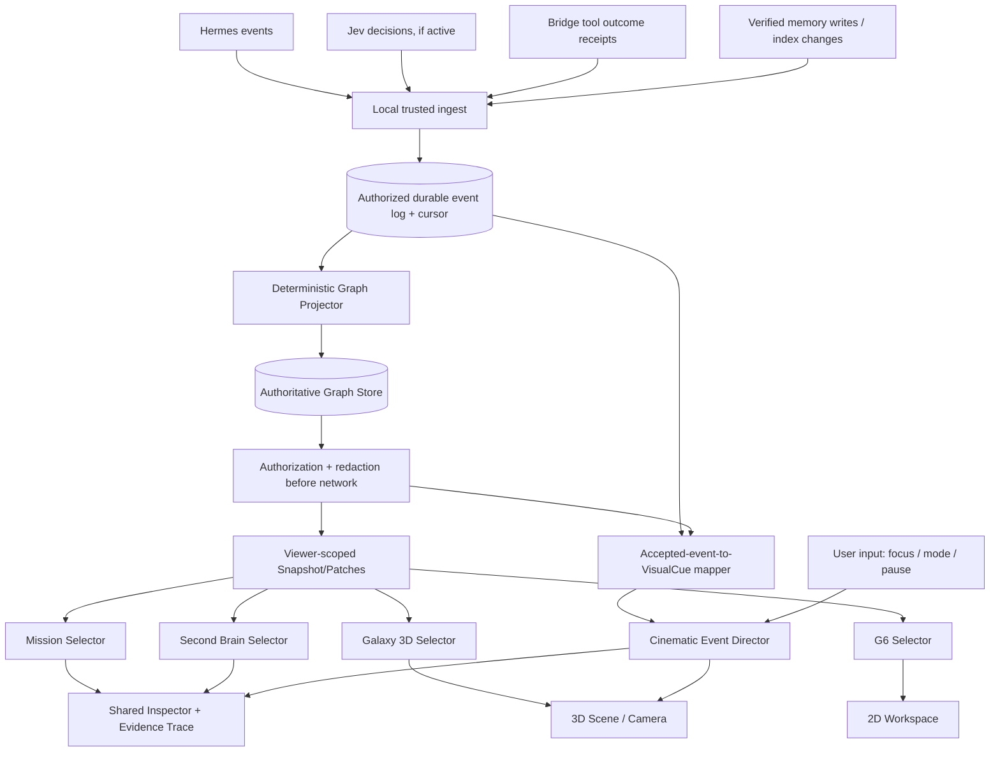

# 14 — Unified System Design Review: Mission Control + Second Brain + Cinematic Director

**Superpowers path:** ARCHITECTURAL — design review, *not* an implementation plan.
**Status:** PROPOSED, awaiting user approval. **Date:** 2026-10-10.

> **2026-10-11 architectural review addendum:** The earlier reconciliation is strengthened by [Doc 16 — Final Architecture Review](16-final-architecture-review.md). The design still needs agreement on **viewer-scoped graphVersion/replay cursors**, **PAUSE visual cues while data stays live**, and **producer event names vs derived transport states**. The Master Spec already contains a documentation-only reconciliation; old implementation plans were annotated, and three separate lens plans have been written. None of this constitutes human sign-off, code implementation, or a REAL-LIVE verification.
**Scope:** Reconcile documents 01–13. **Repository:** experimental `Experental-MajkelVibeCode/jarvis-graph-3d`, docs branch only.
**Hard constraints:** No product code, no dependencies, no source/running Hermes or Bridge changes, no deployments, no merge into either `main`.

## 0. Shared understanding and intended result

The purpose is not to build three independent dashboards or new agents. We want one believable, navigable visual explanation of **what Jarvis is doing, what it knows, and which consequences are actually confirmed**, with the ability to go from system overview to a specific task, memory, decision, source and evidence. The user chooses a view, focus and timescale; the scene never claims a simulated signal is an actual tool execution.

Success for this design review:
- one common set of domain IDs and graph revision rules;
- one event interpretation and evidence policy;
- separate presentation projections with shared security and search;
- a camera/effects policy that never overrides manual interaction;
- an explicit list of decisions the user still has to approve, plus testable examples.

Not part of this step: writing TypeScript implementations, patching Bridge, installing G6, testing real runtime or deploying.

## 1. Alternatives considered

| Approach | Architecture | Advantages | Problems | Decision |
|---|---|---|---|---|
| **A: shared canonical domain + independent views** | Event Log → Projector → Graph Store → viewer-scoped selectors → Mission/Brain/3D/G6 | Same truth, verifiable provenance, incremental rollout, future command isolation | Requires contract freeze; selectors and transport discipline | **Recommended** |
| B: each view owns a store | Mission, Memory, Galaxy maintain independent entities and sync events | Quick isolated demos | Competing IDs/statuses, drift, privacy inconsistency, costly reconciliation | Reject for v2 |
| C: one huge graph view renders everything | Every task, memory, event and relation in one force graph | Fewer view components initially | Collapses UX, performance and evidence semantics into shader/physics; hard to scale | Reject for v2 |

**Why A:** The existing 3D prototype can remain a renderer, and the three new features can be progressively disclosed using the same contract. This is a *design recommendation*, not a ratified ADR.

## 2. Single end-to-end data flow



**Important refinement:** The cue mapper must use **accepted, deduplicated, authorized events** *and* the current projected state. Some important status/progress events are semantic no-ops for the domain graph but can still produce a permitted UI cue. Do not require every cue to coincide with a non-empty GraphPatch; require an accepted event whose target is authorized, with an explicit replay/duplicate policy. A tool failure remains a durable evidence/timeline update even when target node is outside current LOD.

## 3. Ownership and single sources of truth

| Thing | Owner | Read by | Forbidden |
|---|---|---|---|
| Event identity, source, cursor and durable status | authenticated producer + ingest/log | Projector, Timeline, replay | graphics inventing success |
| Entity ID, kind, relations, revisions | canonical Graph Store | all view selectors, Inspector | renderer mutation of GraphEntity |
| Tool success/failure | authoritative Bridge/tool outcome (to be verified) | Mission, Brain evidence, Director | treating LLM text as an outcome receipt |
| Persistence of memory | approved memory source with confirmed write | Second Brain, project relations | treating a suggested note as persisted |
| Classification and access scope | trusted server/gateway | redacted viewer snapshot | UI hiding private data only with CSS |
| Camera position and selection | client-side ViewState / CameraDirector | Galaxy, Inspector, G6 selection | changing authoritative graph or calling tools |
| Ambient and event-driven animations | Cinematic Director | canvas/evidence list | events being generated solely to play an FX |
| Machine performance/LOD | quality policy | Galaxy, G6, Director | altering domain truth or hiding alerts |

## 4. Canonical naming to propose for contract freeze

Use **Blueprint 02** vocabulary:
- `GraphEntity` with `kind`, `status`, `provenance`, `revision`, `classification`.
- `GraphRelation` with `kind`, `sourceId`, `targetId` and direction.
- `GraphSnapshot` with `schemaVersion='2.0'`, `graphVersion`, `cursor`.
- `GraphPatch` with `baseVersion`, versioned upsert/deletion arrays.
- `JarvisEventV1` with CloudEvents-like `id`, `source`, `type`, `time`, `sequence`, `correlationid` and bounded `data`.
- `ViewState`: selection, semantic L0–L3, filter, camera and FOLLOW LIVE; NOT persisted as a project/memory fact.
- `VisualCue`: derived transient display request tied to accepted event identity and target ID.

**Compatibility warning:** The older master spec calls the canonical node `GraphNode` and includes `core` as a domain kind, while new docs propose `GraphEntity` and `system`. Do not edit implementer instructions to say both are authoritative. We propose `GraphEntity` as canonical; master spec awaits explicit sign-off before being marked superseded.

### Versioning is three separate concepts

```text
(source, event.id, source-local sequence) = event identity/order
server cursor                         = durable log replay position
graphVersion + entity revision        = materialized graph state
viewer access scope                   = determines which snapshot/patch is allowed
```

A `partitionkey` by itself **does not** guarantee ordering per task. A viewer changing access scope requires a new authorized snapshot; a cursor from previous permissions cannot be blindly reused.

## 5. Resolve apparent contradictions

| Issue | Existing docs | Unified design rule | Review state |
|---|---|---|---|
| User-facing modes | Master: SYSTEM/AGENTS/PROJECTS/MEMORY/LIVE. Mission 11: Universe/Mission/Team/Trace/Timeline | The first five are **top-level navigation modes**; Mission, Team, Trace and Timeline are **subviews/contextual lenses**, not five extra top-level tabs | Proposal |
| Zoom vs view | 04 defines L0–L3; 11/12 introduce specialist views | L0–L3 describe **semantic detail across contexts**. L3 = evidence panel/trace, not mandatory separate 3D scene | Proposal |
| Memory `persisted` | 12 calls a memory item `persisted`; EntityStatus enum has no `persisted` | Keep entity status `unknown/idle/queued/running/blocked/succeeded/failed/cancelled/archived`; model **persistenceVerification: pending/confirmed/failed/unknown** separately as versioned, typed source-derived metadata. No new enum until ontology ADR approves | Proposal |
| Memory link `suggested` | 12 proposes `verification` and `confidence` on edge, absent from GraphRelation interface | Treat as candidate typed relation attributes in separate versioned claim/provenance schema. Suggested similarity ≠ established domain relation; do not put unapproved suggestions in authoritative relation set as verified | Proposal |
| `task.completed` vs tool outcome | 11–13 use task.completed to conclude work | Task lifecycle event != proof of external side effect; tool/Bridge receipt and evidenceRef drive verified operation status. UI keeps separate task, run, tool and transport statuses | Existing design invariant |
| Names of new event types | 11/13 use `task.assigned`, `memory.written`, `source.disconnected`, not verified in runtime | Define these as **semantic event candidates**, mapped only after read-only source inventory; `source.disconnected` may be a derived client connection state rather than durable producer event | Proposal |
| Animation cue trigger | 13 says after GraphPatch commit | after accepted/deduped authorized event plus a compatible projected state/cursor; event may produce no graph topology change, but no cue should replay twice accidentally | Refinement |
| Replay and PAUSE | 04/13 permit pause stream; 03 requires gap detection | PAUSE = stop **visual event playback** by default, not discard durable transport; on resume replay from cursor or resync. Freeze 3D simulation is a separate command | Proposal |
| Snapshot time-travel | 12 proposes yesterday's state | display historical state only if event log/snapshot retention covers period; explicitly show incomplete history if gaps | Existing design invariant |
| 120 agents | Mission describes 20 managers + 100 members | this is a **DEMO stress fixture**, not proof 120 online runtimes; aggregate with LOD | Existing design invariant |
| Mission actions | Mission could show retry/approve buttons later | v2 view-only, no commands from graph clicks. Separate future command/authZ spec and approval | Existing security invariant |
| Private aggregate counts | memory map and Mission group counts | counts derived only from entities/relations visible in viewer authorization scope; no leakage through missing edge IDs | Existing security invariant |

## 6. Four user stories with exact semantic ownership

### Story A — Delegation

Hermes plans task → `task` appears, marked queued → delegate event from authenticated source → `assigned_to` points to agent → if/when verified run/tool starts, show running → after real result, show outcome and evidence. **Mission** displays ownership. **Second Brain** connects stored decision to the task *if there is evidence*. **Director** emits one cue on real assignment/start, never reports final success on mere delegation.

### Story B — An approval blocks the pipeline

`approval.requested` arrives → Mission marks affected task blocked and names allowed approver if source provides it → Second Brain can show decision context but cannot fabricate justification → Director shows warning ring and accessible label; camera remains untouched. Approval UI is a separate future authorization project.

### Story C — Memory update

Agent proposes saving a memory → no permanent memory node yet → source confirms write with stable ID → canonical memory reference becomes materialized and tied to project/task → Second Brain shows verified source and timestamp → Director plays one birth pulse on target if viewer authorized; if not visible in LOD, timeline only.

### Story D — Browser disconnect / resume

Transport drops → graph remains with last-known values plus STALE timestamp → no fresh animated LIVE events → reconnect obtains safe replay or new authorized snapshot → no duplicate fireworks or tool calls → user-selected camera/focus is preserved when IDs remain valid.

## 7. Navigation and information architecture

Five top-level modes remain: **SYSTEM, AGENTS, PROJECTS, MEMORY, LIVE**. Within them:

| Top-level mode | Common lenses | Semantic levels L0–L3 |
|---|---|---|
| SYSTEM | Universe, Connection Health | whole OS → component → evidence |
| AGENTS | Team, Mission, Agent Trace | teams → agent → assigned tasks → outcomes |
| PROJECTS | Mission, Dependencies (G6), Timeline | portfolio → project → task/run → proof |
| MEMORY | Second Brain, Source Trace | topics → records → linked decisions → source |
| LIVE | Activity Feed, Follow, Replay | aggregate activity → task → run → event proof |

Switching tabs changes **projection and camera intent**, not graph truth. Selectors share stable IDs. G6 is a separate renderer to the same authorized snapshot.

## 8. Non-functional contracts

- **Safety:** browser never receives raw Bridge token, private file body or forbidden aggregate; all input schemas bounded and validated before projection.
- **Evidence:** every displayed claim of completed tool action has authoritative source receipt; otherwise marked unknown/unverified.
- **UX:** L0 legible; L3 exact source, time, correlation and confidence distinction. Reduced motion and keyboard/search-based alternative to canvas.
- **Performance:** budgets are proposed until tested; 500/1500 desktop and 2000/4000 stress benchmark plus 200-node mobile profile.
- **Recovery:** disconnect = STALE; replay = read-only; missing cursor/version = resync.
- **Isolation:** only docs branch changed; no code or live connection.

## 9. Design review gates — NOT implementation gates

- **DR-1:** confirm canonical names and map old master spec conflicts (02 vs master). 
- **DR-2:** decide task/run/tool success semantics and memory persistence verification, based on authorized read-only evidence.
- **DR-3:** approve top-level modes/subviews, L0–L3 and camera override.
- **DR-4:** approve visual event cue rules with duplicate, replay and pause behavior.
- **DR-5:** approve privacy boundary, local-only LIVE default and review matrix.
- **DR-6:** approve written spec; **only then** write a Superpowers implementation plan. Another explicit instruction would still be needed before implementation, and main stays untouched unless separately approved.

## 10. Suggested reviewer decisions

| Decision | Recommendation | Why |
|---|---|---|
| 3 independent apps or 1 shared graph? | One canonical graph + three contextual lenses | Consistent evidence and IDs |
| Master type name | `GraphEntity`, visual `GalaxyNodeDTO` | Domain separated from rendering |
| Task and result | independent statuses and evidence | Avoid false success |
| Memory source | source-verified, restricted by default | Protect real private records |
| L3 representation | evidence inspector + local emphasis | Faster and more legible than giant 3D sub-scene |
| Camera event takeover | none unless explicitly FOLLOW LIVE | Protect user orientation |
| Hosted Preview | synthetic DEMO by default | No unapproved local exposure |
| Next document | Superpowers **design review / sign-off checklist**, not coding plan | Design stage is not yet approved |

**This design has not been approved by the user.** It is ready for review and corrections, not execution.

## References

- [Blueprint 02 — Graph Ontology](02-graph-ontology-contracts.md)
- [Blueprint 03 — Event Protocol](03-event-bus-protocol.md)
- [Blueprint 04 — Semantic Zoom](04-interaction-semantic-zoom.md)
- [Blueprint 08 — Candidate ADRs](08-architecture-decisions-candidate.md)
- [Blueprint 10 — Acceptance Scenarios](10-acceptance-scenarios-and-evidence.md)
- [Blueprint 11 — Mission Control](11-mission-control-design.md)
- [Blueprint 12 — Second Brain](12-second-brain-graph-design.md)
- [Blueprint 13 — Cinematic Event Director](13-cinematic-event-director-design.md)
