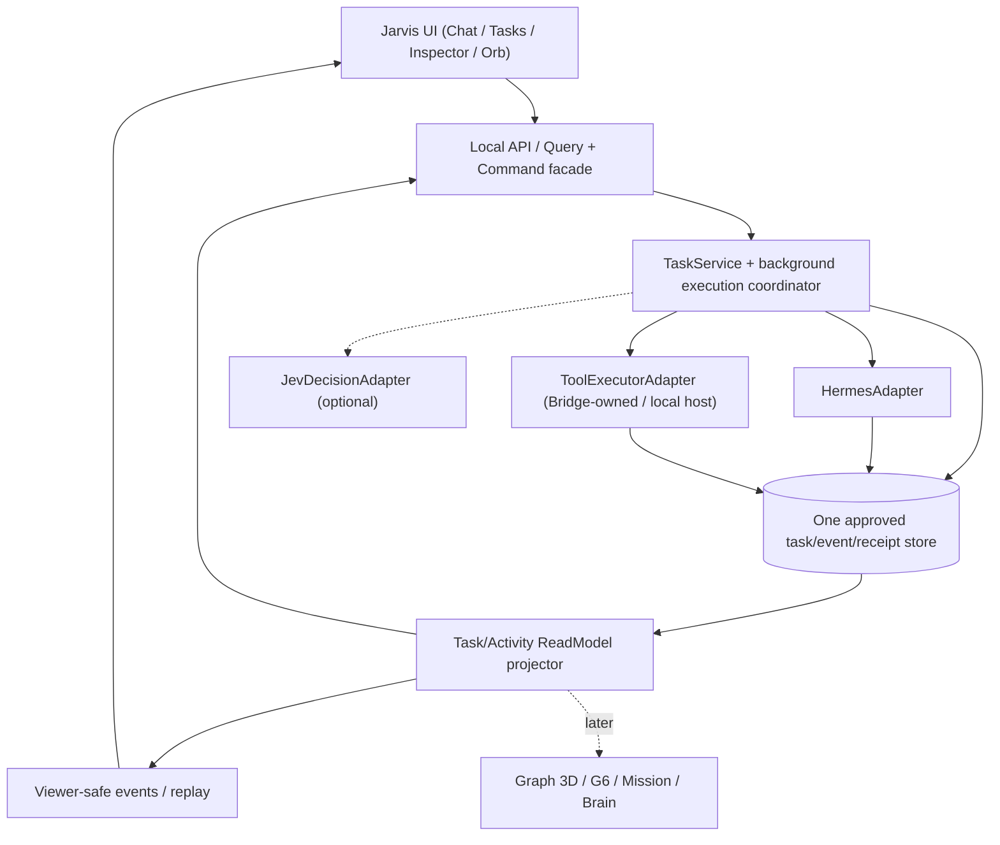

# Jarvis OS MVP — Small Working Core, Modular Scale (Design Specification)

> **Audyt lokalnego systemu — 11.10.2026:** porty 4000/8651/8642 potwierdzono w procesach na laptopie; stan repo i cztery zmodyfikowane pliki odczytano bez zmian. Pełne wyniki: [02 — audyt](../templates/jarvis-mvp/02-AUDYT-WYNIKI-2026-10-11.md), a konkretny plan następnych prac: [07 — plan po audycie](../templates/jarvis-mvp/07-PLAN-MVP-PO-AUDYCIE-2026-10-11.md). Nie testowano wykonania zadania E2E, nie ustalono aktywnego profilu gatewaya ani właściciela bazy. **MVP nadal nie jest wdrożone.**

**Superpowers path:** ARCHITECTURAL / design document; **status: DRAFT, UNAPPROVED**, 2026-10-11.
**Project:** Existing `Jarvis-` OS plus the separate `jarvis-graph-3d` visual experiment — **NOT** a new independent Jarvis platform.
**Location:** planning branch `docs/jarvis-graph-v2-mission-brain-motion` of `majkel2403/Experental-MajkelVibeCode`. No product code or `main` changes.
**User intent (from conversation):** Make Jarvis a real, dependable AI desktop assistant first; allow modular scaling later without duplicate app cores, Hermes instances, task histories, stores or UI shells. Keep Hermes as the intelligence/orchestrator, Bridge as tool execution adapter, Jev as an optional decision layer, real events driving the UI. Avoid a giant speculative rewrite.

## 1. MVP in one sentence

**Jarvis MVP is working when one user instruction reaches a real Hermes session, a real bounded tool action is executed by a background-capable host (not the open browser tab), the resulting state and proof are persisted, and the user can inspect/reopen the result with no fabricated success — including after a browser close/reopen.**

The MVP is **not** defined by the presence of an Orb, 3D graph, number of agents, a model's self-report or a green UI status.

### The flagship end-to-end scenario

User types: **„Sprawdź stan projektu Jarvis i zapisz raport w wybranym katalogu roboczym”.**

1. Jarvis creates a unique `TaskId`, records the instruction in the authorized task store and acknowledges it once.
2. Hermes receives the task through the currently configured, verified adapter and creates the execution plan.
3. A Bridge-owned/background-capable tool (or an approved local execution host) gathers read-only repo status, then writes an explicitly scoped report.
4. An authenticated tool receipt with exit status, artifact reference and correlation to `TaskId` is recorded.
5. Jarvis distinguishes “Hermes answered” from “report file was really written”. It shows exact task state, tool outcome, errors, and safe report link.
6. Browser can be closed during execution; server-side task state continues without depending on the PWA tab. Reopening reconstructs task/timeline via an authorized read model.
7. If Bridge or Hermes disconnects, task is NOT marked completed or silently replayed as a second command. The UI shows `STALE/UNKNOWN` and reconnect/reconcile.
8. The same task identity and events can drive a simple Orb/Activity Log and, later, Graph 3D without changing core semantics.

This example is a **future acceptance scenario**, not proof that current Bridge can perform all steps headlessly. Existing Bridge has browser-mediated tools as well as Bridge-owned tools. The MVP must explicitly use a tool path that does not depend on an open browser, or add a minimal approved local host after read-only runtime inventory.

## 2. Three architectural paths considered

| Option | Approach | Advantage | Disadvantage | Recommendation |
|---|---|---|---|---|
| A | Fully rewrite Jarvis, Hermes integration and Graph before a release | A clean conceptual blank slate | Repeats working logic, regression risk, multiple duplicate projects | **Reject for MVP** |
| B | Add new UI pages to existing browser-owned flow, keep ephemeral events | Quick to demo | Doesn't meet background work, restart/reconnect or truthful execution requirement | **Use only as UX demo, not MVP** |
| C | **Modular local core built around verified existing Hermes/Bridge adapters, with incremental replacement behind contracts** | Reuses actual code, creates a clear testable vertical slice and future modules | Requires cleanup, source audit, contracts and migration discipline | **Recommended** |

**Deployment style:** a **modular monolith**, not microservices for every feature. Hermes may remain its existing separate process. The existing Bridge/local service should host or delegate the minimal core responsibilities *where verified safe*; reuse its running infrastructure instead of launching a second competing gateway. No second Hermes installation, Bridge duplicate, database clone or another Jarvis front-end without deliberate ADR.

## 3. Minimum features — must have vs next versions

| Area | MVP required | Explicitly deferred |
|---|---|---|
| Command | One reliable task submission via chat to configured Hermes | voice, multi-model routing marketplace |
| Background execution | One genuine tool action whose execution is not dependent on browser being open | generic desktop automation of everything |
| Status & proof | pending/running/blocked/completed/failed/cancelled/unknown with proven receipts; task vs tool vs connection distinct | predictive progress, arbitrary agent self-reported “100% done” |
| Persistence | Recover tasks and relevant event/receipt history across tab close, app restart per agreed retention | full arbitrary time-travel knowledge graph |
| UI | chat + tasks + selected task details/event timeline + connection state, mobile 390×844 | full window manager, Galaxy 3D and G6 workspace |
| Feedback | small Orb or basic visual status tied to accepted events, explicitly DEMO if fixture | cinematic shaders, particle galaxy |
| Plugins | documented module contract and 1 real tool adapter; Jev disabled without breaking flow | plugin store / dynamic marketplace / hundreds of agents |
| Operation | simple start/stop, error log, health check, single user local profile | hosted remote public admin / enterprise multi-tenancy |
| Quality | unit, integration and true end-to-end smoke for flagship command | full 2k/4k graph benchmark and mobile remote live |
| Security | limited tool scope, existing tokens stay server-side where possible, local-only MVP | internet-wide remote control, tokenized SSE query for hosted app |

**Necessary distinction:** a safe read-only authorized repo status is useful for the first proof, but the full success criterion includes one **scoped write with file existence/content verification** or equivalently verifiable actual tool side effect. Dry-run or model prose is not enough.

## 4. User-visible MVP — one screen, four simple areas

A. **Chat / Command Box**: issue the goal and see acknowledgement with `TaskId`, not pretend a model's thinking text is a finished task.

B. **Task list**: now, recent, failed, blocked; clear source of state, last update and actionability. Never suppress interrupted tasks.

C. **Selected task inspector / Process Log**: steps, actual tool starts/outcomes with evidence reference, last connection event, error and reason. Show unknowns explicitly.

D. **System status / minimal Orb**: Hermes connected or stale, execution host/Bridge available, current task count; small event-driven animation, no 3D requirement.

Mobile 390×844 is a **responsive stacked adaptation** of the same content, not another source of truth. The UI must remain useful with WebGL disabled.

## 5. Single modular core — clear ownership



**This is a logical design, not a claim that all modules or APIs exist today.**

### Layer contracts (candidate, no wire schema freeze)

- `TaskService`: accepts `SubmitTask(command, idempotencyKey, requestedScope)` and returns stable `taskId`. Owns lifecycle transitions. Not hosted in React state.
- `ExecutionCoordinator`: records scheduled/running runs, chooses one **approved** background-capable execution path, retries only idempotent operations and marks uncertain outcomes for reconciliation. Not a second agent planner.
- `HermesAdapter`: invokes/configures the **existing** Hermes session with `taskId/runId` correlation; captures answer/run status as separate evidence. No second Hermes runtime.
- `ToolExecutorAdapter`: uses existing Bridge-owned tools or approved local execution host with explicit scope; captures tool outcomes. Browser clicker tasks that require a live card are **not accepted for background MVP**.
- `JevDecisionAdapter`: optional; `null/disabled` path remains correct; its output is a decision proposal, not a tool receipt.
- `EventLog/Store`: one approved local persistent owner (re-use a suitable existing store if source audit proves safe; otherwise one minimal isolated store with migration/backup). Records task, run, attempts, tool receipts and accepted events. Existing `agent-history.jsonl` remains a compatibility summary.
- `ReadModel`: projects authoritative events into task lists, status, inspector; viewers see only permitted data. Old `js/events.js` remains legacy UI compatibility until explicitly migrated.
- `ModuleRegistry`: static first: manifest with `id`, `version`, `dependencies`, `capabilities`, `uiEntry?`, `eventSubscriptions`; no runtime hot-plug or microservice required for MVP.

**Key rule:** modules are not allowed to write each other's tables/entities directly. They communicate via stable command/query APIs and versioned event handlers; no cyclic module imports. This is how scaling stays easy.

## 6. One stable core model

Candidate TypeScript semantics; detailed schema to be ratified after code and local-runtime evidence:

```ts
type TaskId = string; // opaque stable ID, collision guarded
type RunId = string;
type ToolAttemptId = string;
type TaskStatus = 'queued'|'running'|'blocked'|'succeeded'|'failed'|'cancelled'|'unknown';
type Connectivity = 'connected'|'stale'|'disconnected'|'unauthorized';
interface TaskRecord {
  id: TaskId;
  commandSummary: string;
  status: TaskStatus;
  createdAt: string;
  updatedAt: string;
  currentRunId?: RunId;
  resultEvidenceRef?: string;
}
interface TaskEvent {
  id: string;           // stable producer/source-scoped identity
  taskId: TaskId;
  runId?: RunId;
  type: string;
  occurredAt: string;
  source: string;
  evidenceRef?: string;
}
interface ToolReceipt {
  toolAttemptId: ToolAttemptId;
  runId: RunId;
  toolName: string;
  outcome: 'succeeded'|'failed'|'timeout'|'denied'|'unknown';
  source: string;
  evidenceRef?: string; // actual tool result, not model prose
}
interface ModuleManifest {
  id: string; version: string;
  dependencies: string[];
  capabilities: string[];
  eventSubscriptions?: string[];
  uiEntry?: string;
}
```

**Not yet frozen:**
- How and where the installed Hermes reports turn/run termination and tool-call IDs.
- Idempotency and replay across the current Bridge / Hermes versions.
- Which existing DB safely owns task persistence, or whether a new small store is necessary.
- Which scope and artifact locations a real user permits.
- Authorized viewer projection revisions and cursor (see Blueprint 16/F1).
- Module packaging shape (static registry initially; npm workspaces or plugins only after actual need).

## 7. Module boundaries now vs later

### MVP core modules (only these are required)

| Core unit | Has own responsibility | Must not do |
|---|---|---|
| Task | status, task identity, scheduling/reconciliation | render 3D or assume tool executed |
| Hermes integration | session/run and AI reply hand-off | store an independent task DB or issue Bridge action without coordinator |
| Execution/Bridge integration | bounded tool dispatch + verified result | depend on open PWA tab |
| Storage/events | durable event and receipt authority, lifecycle history | decide task status from animated particles |
| UI shell | chat/list/inspector minimal Orb and health info | directly own running job state, privileged secrets or persistence |
| Module registry | declarative capabilities, route/UI visibility, optionality | dynamic plugin marketplace and arbitrary code execution |

### Expansion modules (drop in later)

**Mission Control** reads Task/Agent/Tool projections; **Second Brain** reads an approved memory index + provenance; **Galaxy 3D** visualizes projections; **G6** uses the same IDs; **Jev** is an optional decision adapter; **Trading Lab** uses a different domain provider but the same task/event permission mechanisms; **Window Manager** is UI-only composition.

No expansion module may require rebuilding TaskService or replacing the existing Hermes/Bridge services.

## 8. Sequence: build one vertical slice, not 10 unfinished phases

| Phase | Output / proof | Required prerequisite | Explicitly NOT in scope |
|---|---|---|---|
| M0 — Audit running reality | sanitized map of actual Hermes process/profile, Bridge tool categories (browser vs background), existing DB, current auth, code SHAs; list **reuse vs conflicts** | owner-permitted read-only local audit | fixing code on the fly |
| M1 — Contract & test-fixture freeze | task/run/tool lifecycle names, exactly one event identity model, ownership of store, minimal command/reply APIs and mock fixtures; approved design | current source proof | implementing all Graph contracts |
| M2 — Local backend vertical slice | one TaskService, background-capable tool adapter, minimal durable events, health; test one task without browser tab | M0/M1 | distributed agents |
| M3 — Minimal UI | chat, tasks, inspector, accessible Orb/status; one read-model feed, mobile layout | M2 | full Galaxy/G6 |
| M4 — Evidence and recovery | restart, reconnect, retry/dedupe, missing receipt, wrong token, tool error; E2E automation evidence | M2/M3 | “autonomy” by unbounded yolo |
| M5 — First release gate | demo video/screenshot + exact test/commit evidence, local MVP marked READY only if tests pass | M4 | merge/deploy without separate approval |
| M6 — Post-MVP modules | Mission, Second Brain, Graph 3D, richer agent teams/Jev | MVP proven | retroactive rewrite of core |

**Build order deliberately changes priority:** previously we described Graph v2 details. **Jarvis OS MVP core must be proven before those modules become release dependencies.** Their design docs remain valid as future extensions, not conditions for shipping the first useful Jarvis.

## 9. Definition of Done — observable outcomes, not optimistic claims

All mandatory for release label **JARVIS MVP WORKS**:

1. **Real command:** from UI, send a new bounded command, obtain stable taskId, see one Hermes run and one actual tool attempt tied to same task.
2. **Actual result:** authoritative tool outcome (including scoped artifact write/read-back or other verified effect) is displayed with evidence; nonempty LLM answer alone can NEVER turn tool output green.
3. **Browser independent:** close the PWA while the task is in progress; the explicitly designated background-capable tool path keeps running and state is queryable after reopening.
4. **Persistence:** restart only the browser and then restart the designated local execution service in a **controlled test**; current task and past evidence are recovered or clearly marked incomplete, not silently replayed as fresh side effects.
5. **Loss and retry:** disconnect Bridge/disable adapter within test harness; UI says STALE or UNKNOWN, no forged `succeeded`; retry idempotency prevents a duplicated write if ACK was lost.
6. **Error truthfulness:** a failing command displays actual failed run, sanitized error and a clear path to inspect, while task and tool statuses remain distinct.
7. **UX:** chat + task list + inspector work at desktop and 390×844 mobile; WebGL optional; keyboard access and reasonable readable fallback.
8. **Optional Jev:** disabled or absent Jev does not break the end-to-end task.
9. **Module isolation:** a sample placeholder plugin/module can be registered/unregistered without changing TaskService or copying a database; it cannot run arbitrary privileged commands just because it is enabled.
10. **Evidence:** tests, screen record, full command result, exact commit, known limitations; ALL verified in the real authorized environment. Do not label mere Github Actions green / Vercel READY as runtime pass.

No hard 99.9% availability or latency claims before measurement. Document measured runtime timings and recovery windows during acceptance.

## 10. What NOT to build for the first release

- A rewrite into a second independent all-in-one Jarvis platform — outside this project scope.
- Galaxy 3D, G6, elaborate particles/5D neural maps as a blocker for usable MVP.
- 20+ managers, 100+ real agents, automatic massive delegation, autonomous finance execution.
- Remote public access to local machine, production trading or mobile cloud control.
- A universal plugin marketplace / dynamic untrusted code loader.
- Five parallel databases, competing Bridge instances or second memory source.
- Full replay/time machine or long-term vector memory before reliable task result and history.
- Excessive security theatre **or** bypassing basic authenticated tool scope and preventing secret leaks — the minimum trust boundary is mandatory.

## 11. Current verified source baseline / blockers

**Verified from GitHub source (not live Windows runtime):**
- Current Hermes `jarvis-events` hook can silently drop events, and maps nonempty `post_llm_call` text to `task.completed`. Source inventory: [Blueprint 17](../../graph-v2/blueprint/17-read-only-code-evidence-inventory.md).
- Bridge has `/bridge/agent-event`, bounded in-memory full-event deque, limited disk task summaries (`bridge/day_history.py`), SSE to connected browser and browser-dependent execution paths plus selected Bridge-owned tools.
- Standalone Graph 3D seeded fixture with events on a 2500ms timer, not actual LIVE.
- Existing `js/events.js` is a local UI reducer/history; it is not a cross-restart task authority.

**Blocking unknowns:**
- Current installed Hermes/Bridge code and runtime health, real background-tool classifications and user-approved workspace.
- Storage location/ownership that won't conflict with existing Hermes `state.db` and Jarvis caches.
- Verified run/receipt semantics, auth topology, supported reconnect/replay.
- Whether one scoped report can be created and verified without tab open on current setup.

Until M0 is done, no claim that feature is already running nor that the proposed directory is the correct installed runtime.

## 12. Design review and execution boundaries

**Recommendation to the user:** treat this as the **MVP-first product north star**; the 18 Graph Blueprint docs are supporting future module requirements. Review the definition of MVP and the six-layer contracts before signing off. User consent to design does not automatically consent to product code changes or merging `main`.

- [x] Design proposal is written on docs branch.
- [ ] User architecture review / revisions (no silent sign-off).
- [ ] Controlled read-only local audit (once authorized via relevant local connector).
- [ ] Single small Superpowers implementation plan based on the verified current source and this design, using TDD.
- [ ] Separate explicit implementation authorization, then isolated feature branch and real tests.
- [ ] Real MVP end-to-end proof with saved evidence, then decide on modules.

**References:** [Graph Blueprint README](../../graph-v2/blueprint/README.md), [Doc 18 incremental migration](../../graph-v2/blueprint/18-evidence-driven-contract-migration.md), [Doc 14 unified model](../../graph-v2/blueprint/14-unified-system-design-review.md), [Doc 09 runtime audit plan](../../graph-v2/blueprint/09-read-only-source-verification-plan.md).

**Status statement:** This design is a written candidate. None of its target behavior has been implemented or tested as part of creating this file.
