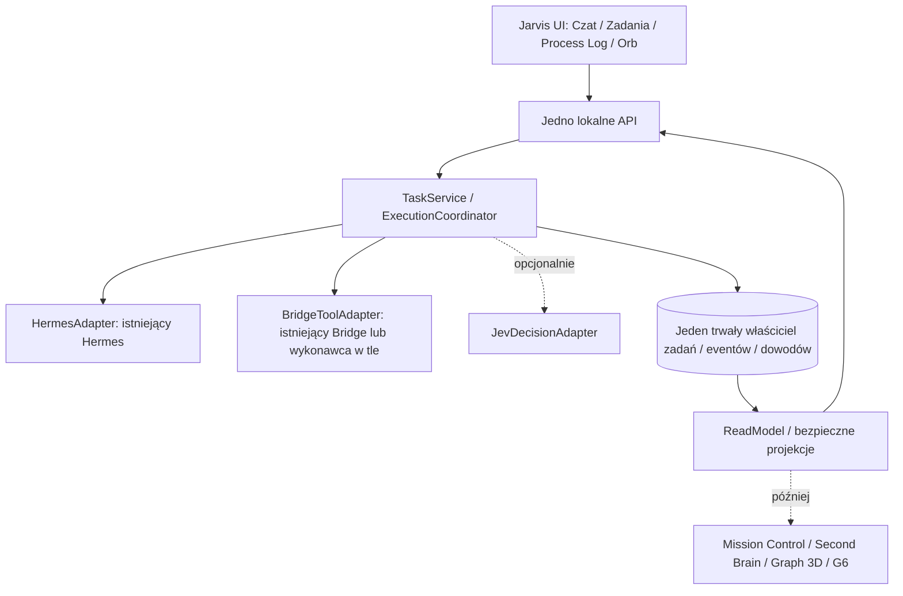

# 03 — Jarvis MVP: modułowa architektura, kontrakty i skalowanie

> **Jarvis MVP / Superpowers — szablon roboczy, 2026-10-11.** Wypełniaj na podstawie dowodów. `[DO UZUPEŁNIENIA]` oznacza otwartą decyzję; `[NIEZWERYFIKOWANE]` nie znaczy „działa”. Te dokumenty NIE są zgodą na implementację, instalowanie, zmianę `main` ani ingerencję w działającego Hermesa.

**Status:** DRAFT; architektura proponowana, niepotwierdzona stanem runtime. **Styl:** modularny monolit + już istniejący Hermes; bez mikroserwisów dla każdego widżetu.

## 1. Jedna prawda, wiele modułów



**Zasada:** Hermes planuje i rozmawia; Bridge/narzędzia wykonują; Core pilnuje identyfikatorów, stanu i dowodów; UI tylko wyświetla. Pojedyncze moduły nie zakładają własnych kopii tych samych baz.

## 2. Podział odpowiedzialności

| Moduł | Jedyna odpowiedzialność | Nie może robić |
|---|---|---|
| `core/tasks` | TaskId, cykl życia, stan i właściciel | renderowanie 3D |
| `core/execution` | przydział wykonania, próba, retry/dedupe | uznawanie tekstu LLM za proof |
| `adapters/hermes` | połączenie z aktywnym Hermesem | tworzenie nowej instancji Hermesa |
| `adapters/bridge` | narzędzie, potwierdzenie, błąd | wymaganie karty dla pierwszego testu background |
| `core/events` | walidacja, zapis i odczyt zdarzeń | efektowne animacje |
| `core/modules` | statyczny rejestr modułów i uprawnień | arbitralny kod pluginów z sieci |
| `ui/shell` | czat, lista, inspektor, minimalny Orb | własna niezależna baza zadań |
| `adapters/jev` | opcjonalna rekomendacja/klasyfikacja | klikanie i wykonanie narzędzi |

**Nazwy folderów są propozycją — ostateczne ścieżki ustali audyt 02.** Nie przepisywać obecnego repo tylko po to, aby dopasować je do tabeli.

## 3. Jak dodać moduł bez naruszania rdzenia?

Proponowany manifest modułu (poglądowy):

```json
{
  "id": "jarvis.mission-control",
  "version": "1.0.0",
  "requiresCore": "1.x",
  "dependencies": ["core.tasks", "core.events"],
  "capabilities": ["tasks.read", "events.read"],
  "events": ["task.updated", "tool.outcome"],
  "uiRoute": "/mission"
}
```

- Moduł **odczytuje** dane przez publiczne API/selektory, nie bezpośrednio cudze tabele.
- Moduł nie zmienia semantyki `TaskId`, historii ani wyników narzędzi.
- Zmiany w kontraktach wersjonujemy; pola opcjonalne przyjmujemy wstecznie kompatybilnie, łamiące zmiany wymagają wersji i migracji.
- Jev wyłączony albo usunięty nie może blokować podstawowego polecenia.
- Wyłączenie modułu tylko usuwa jego funkcję/widok, nie kasuje głównej historii.
- W MVP rejestr **statyczny**, nie dynamiczny sklep pluginów ani ładowanie dowolnego kodu.

## 4. Kierunek zależności (bez cykli)

`UI → Application API → Core → Port(interface) → Adapter`.

Adapter implementuje port; Core nie importuje Reacta, Three.js ani implementacji Bridge. Moduł `mission` nie importuje wnętrza `memory`; jeśli potrzebuje informacji, korzysta ze wspólnych kontraktów/projekcji.

## 5. Jedno źródło prawdy

| Dane | Planowany właściciel | Źródło / wybór po audycie |
|---|---|---|
| Zadanie i jego stan | TaskService | [DB / PATH / SCHEMA] |
| Próba narzędzia | ExecutionCoordinator / tool receipt | [ADAPTER] |
| Zdarzenia i cursor | trwały Event Store | [ISTNIEJĄCA BAZA LUB MINIMALNA NOWA] |
| Pamięć | istniejący system pamięci Hermesa/Obsidian | [DOPIERO MODUŁ PO MVP] |
| Widok i kamera | wyłącznie UI | browser/view state |

## 6. Skala bez mikroserwisów

Najpierw: jedna lokalna aplikacja/API, Hermes jako istniejący proces, Bridge jako istniejący adapter, jedno właścicielstwo zapisu. Później: osobne kolejkowanie, lepszy ReadModel, Graph 3D, G6. **Oddzielne procesy i bazy tylko gdy pomiary i wymagania uzasadnią koszt.**

## 7. Architecture Decision Record (ADR) do wypełnienia

**ADR-ID:** [—] · **Problem:** [—] · **Opcje:** [A/B/C] · **Wybór i dlaczego:** [—] · **Konsekwencje:** [—] · **Dowód:** [—] · **Status:** PROPOSED / ACCEPTED / REJECTED.

## 8. Bramy akceptacji projektu

- [ ] Aktywne runtime/repo/porty są ustalone w audycie 02.
- [ ] Zdefiniowano tylko **jednego właściciela zapisu** dla zadań i zdarzeń.
- [ ] Są kontrakty portów i granice modułów, bez zależności cyklicznych.
- [ ] Jeden działający scenariusz nie potrzebuje otwartej karty.
- [ ] Dodanie przykładowego modułu nie wymaga zmian TaskService.
- [ ] Bez Jev MVP zachowuje się poprawnie.

**Decyzja architektoniczna:** [NIEZATWIERDZONE] · **Uzupełnić po audycie:** [—].
